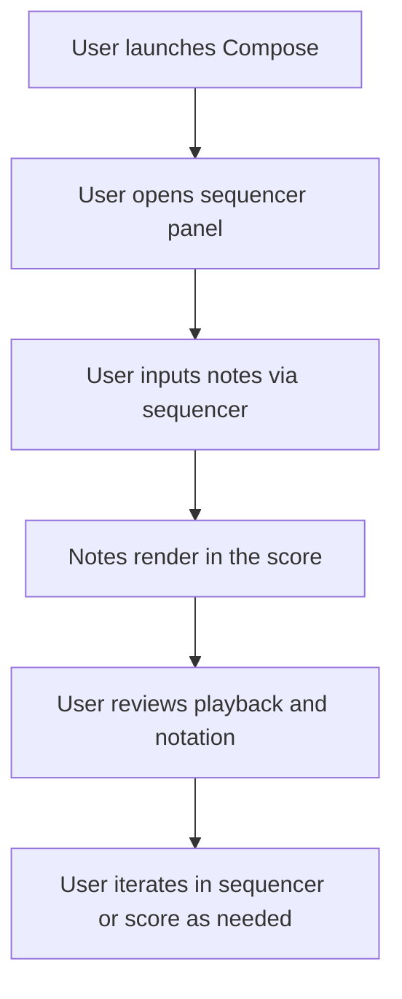
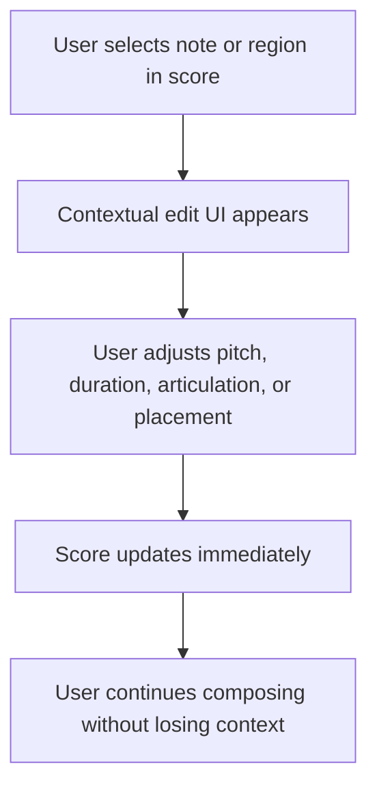
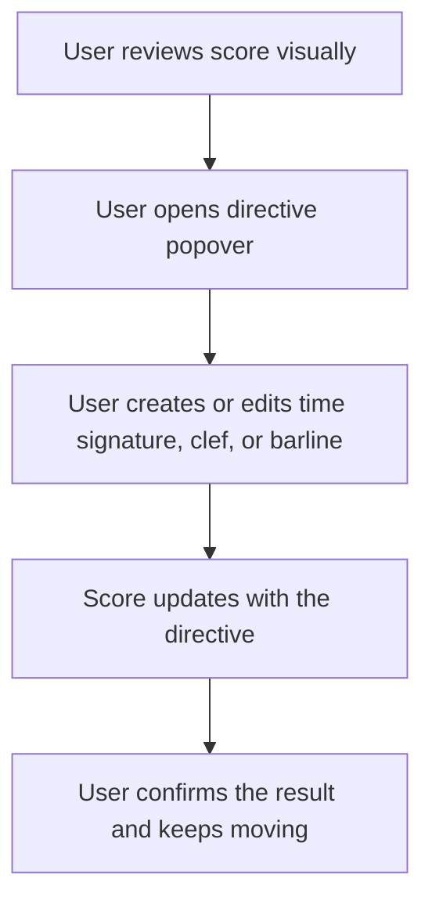

---
stepsCompleted:
  - 1
  - 2
  - 3
  - 4
  - 5
  - 6
  - 7
  - 8
  - 9
  - 10
  - 11
  - 12
  - 13
  - 14
lastStep: 14
inputDocuments:
  - _bmad-output/planning-artifacts/prd.md
  - _bmad-output/planning-artifacts/architecture.md
  - docs/index.md
  - docs/project-context.md
  - docs/project-overview.md
  - docs/component-inventory.md
  - docs/development-guide.md
  - docs/data-models.md
  - docs/architecture.md
  - docs/source-tree-analysis.md
---

# UX Design Specification compose

**Author:** Aled
**Date:** 2026-03-11

---

<!-- UX design content will be appended sequentially through collaborative workflow steps -->

## Executive Summary

### Project Vision

Compose is a native desktop music composition environment built for users who expect musically correct notation, responsive rendering, and a workflow that keeps attention on composition rather than cleanup. Its UX goal is not to simplify music notation into a shallow editor, but to make a sophisticated semantic model feel clear, predictable, and professionally structured. The product should feel like a serious score document tool where correct notation, playback, and editing behavior emerge from a coherent underlying model.

### Target Users

The primary audience is notation-aware composers and musicians who want to enter musical ideas quickly while trusting the application to produce sensible written output by default. A second important audience is engraving-sensitive expert users who judge the tool by readability, professionalism, and fidelity to established notation practice. A third internal audience is the maintainer or debugging user, whose ability to inspect, evolve, and validate the rendering pipeline safely directly affects product reliability and long-term UX quality.

### Key Design Challenges

The first UX challenge is preserving orientation and confidence as the product moves from isolated single-flow presentation to a more continuous score-reading model. Users need to understand where they are, what is active, and how flows relate without feeling that score structure has become ambiguous. The second challenge is expressing a deep semantic model clearly across setup, writing, playback, and engraving-related controls so advanced behavior feels logical instead of scattered. The third challenge is maintaining a native desktop feel while coordinating React-based controls with a Rust-rendered score surface, especially where selection, popovers, and properties editing must feel unified.

### Design Opportunities

Compose has a strong opportunity to differentiate through clarity of information architecture rather than novelty for its own sake. If musical structure, notation appearance, playback behavior, and document/layout concerns are separated in ways users can predict, the product can feel more intelligible than existing professional tools. There is also an opportunity to make the score itself feel like a continuous, professional document earlier in the product's evolution, creating a stronger sense of trust and momentum. Finally, the combination of native rendering performance and notation-aware behavior creates room for a UX that feels both precise and immediate, which is a meaningful competitive advantage in this category.

## Core User Experience

### Defining Experience

The defining experience of Compose is entering, editing, and navigating musical ideas in a way that keeps the user focused on composition rather than notation repair. Users should feel that the product understands the musical structure they are creating and turns that intent into correct, readable score output with minimal intervention. The experience should feel direct and professional: users make musical decisions, and the system responds with precise visual and behavioral coherence.

### Platform Strategy

Compose is a macOS-first native desktop application designed primarily for mouse-and-keyboard use. It should behave like serious desktop document software, with strong support for local file workflows, reliable playback, and offline-first use. The platform strategy should favor native-feeling precision, responsiveness, and stable long-session workflows over web-style interaction patterns or touch-first compromises.

### Effortless Interactions

Music entry and editing should feel immediate, predictable, and low-friction. Selection, note editing, popovers, and property changes on the score surface should feel precise enough that users do not hesitate before acting. Flow navigation should remain continuous and orientation-preserving, so users can read and work across the score without repeatedly stopping to manage view state. The system should also remove unnecessary cleanup work by deriving sensible written notation automatically wherever possible.

### Critical Success Moments

The first major success moment is when a user enters or edits music and immediately sees a clean, musically sensible score result without needing corrective follow-up work. The second is when a larger score remains readable and navigable as a continuous document rather than breaking the user's concentration into isolated rendering contexts. The most fragile make-or-break moment is direct interaction with the rendered score: if selection, editing, targeting, or contextual controls feel imprecise, user trust in the whole product drops quickly.

### Experience Principles

- Compose should let users think in musical intent first and interface mechanics second.
- The score should feel continuous, readable, and professionally structured at all times.
- Precision matters more than visual spectacle; every interaction should reinforce trust.
- Advanced capability should be organized clearly so expert users experience depth without muddle.

## Desired Emotional Response

### Primary Emotional Goals

Compose should make users feel confidently in control of serious musical work. The dominant emotional response should be trust: trust that the product understands musical intent, trust that notation will remain sensible, and trust that direct interaction with the score will be precise. The experience should also support creative focus, so users feel able to stay inside the act of composing rather than shifting into a defensive mode of checking and correcting the software.

### Emotional Journey Mapping

When users first encounter Compose, they should feel that it is a serious, capable, well-structured tool rather than a simplified or improvised editor. During active use, the prevailing feeling should be fluency and calm precision, with the system staying out of the way while still behaving intelligently. After completing meaningful work, users should feel accomplished, reassured, and professionally supported, as though the product helped them produce a score that is already moving toward publishable quality. When returning to the product, they should feel immediate familiarity and confidence rather than relearning or hesitation.

### Micro-Emotions

The most important micro-emotions for Compose are confidence over confusion, trust over skepticism, accomplishment over repair fatigue, and focus over friction. Satisfaction matters more than overt delight, but there is still room for subtle moments of positive surprise when the system handles notation correctly without user intervention. The emotional texture should consistently reinforce that the product is precise, stable, and musically aware.

### Design Implications

If users are meant to feel trust, the interface must behave predictably and expose clear cause-and-effect between musical actions and score outcomes. If users are meant to feel focus, the UI should reduce fragmentation, avoid unnecessary mode friction, and preserve continuity across flows and editing contexts. If users are meant to feel confidence, score interaction must be exact, state changes must be legible, and defaults must be musically sound. Negative emotions such as skepticism or hesitation are most likely to come from ambiguous targeting, hidden logic, scattered controls, or situations where users feel forced to repair output manually.

### Emotional Design Principles

- Every important interaction should reinforce the sense that Compose is precise and dependable.
- The interface should reduce the need for user vigilance by making good notation behavior the default.
- Emotional confidence should come from clarity and consistency, not from decorative reassurance.
- The product should feel calm, serious, and creatively supportive even when users are doing complex work.

## UX Pattern Analysis & Inspiration

### Inspiring Products Analysis

Dorico is the primary inspiration for Compose. Its strongest contribution is its music-first model: users work with musical events, and the software derives written score output according to notation conventions with relatively little manual correction. That aligns closely with Compose's core product philosophy. Dorico also demonstrates the value of strong inline score interactions, good workflow segmentation across major task areas, and performance that remains credible on large scores. Its main weakness, and an important lesson for Compose, is that settings and engraving-related configuration can become muddled, which reduces the clarity of an otherwise strong conceptual system.

Cubase is a useful secondary reference even though it is not primarily notation software. Its strength is pattern consistency across a broad feature set. Users learn a mental model for how the software is organized, and that model continues to hold as the product grows. That consistency is especially relevant for Compose because the long-term product surface spans setup, notation, playback, layout, and potentially automation. Cubase shows the value of making complex software feel predictable through repeatable structural logic rather than through simplification alone.

Sibelius is the main cautionary reference. It remains capable software and demonstrates the value of strong keyboard shortcut support, but its interface organization reflects an older, more visually driven model of score editing. The ribbon-style organization makes tools harder to locate, and users often rely on searching rather than understanding where capabilities belong. For Compose, that is a direct warning against feature placement that follows interface fashion instead of semantic clarity.

### Transferable UX Patterns

The most transferable pattern from Dorico is workflow segmentation around major user intents such as setup, writing, playback, engraving, and output. This supports expert users because it gives them stable conceptual regions for different kinds of work. Also worth adopting is the idea that inline score interaction should be the primary editing surface rather than an awkward bridge to detached configuration panels.

From Cubase, the most valuable transferable pattern is structural consistency. New features should inherit recognizable rules for placement, naming, interaction, and scope so that the product remains legible as it expands. Compose should make users feel that if they understand one part of the application, they can make informed guesses about the rest.

A third transferable pattern across both products is that professional tools can be deep without feeling chaotic if their information architecture mirrors the domain. Compose can apply that by separating musical structure, notation output, playback behavior, and document layout concerns in ways that feel logically inevitable.

### Anti-Patterns to Avoid

Compose should avoid a ribbon-style or tool-dense top-level organization where capability exists but is difficult to locate. It should also avoid placing settings and advanced controls according to implementation history rather than user mental model, since this is one of the main sources of muddle in complex creative tools. A further anti-pattern is leaning too heavily on search as the primary recovery path for poor organization; search can be useful, but users should usually know where something belongs without needing to hunt for it.

Compose should also avoid a purely visual editing model that treats notation as graphical manipulation first and musical structure second. That would cut directly against the product's defining value.

### Design Inspiration Strategy

What to adopt: Compose should adopt Dorico's music-first philosophy, strong workflow partitioning, and inline editing confidence, while also adopting Cubase's consistency in how features are introduced and organized. These patterns directly support Compose's goals of trust, expert fluency, and domain-faithful structure.

What to adapt: Compose should adapt the idea of mode or tab-based workflow segmentation, but with stricter semantic placement rules than Dorico currently achieves around settings and engraving-related controls. It should also adapt pro-audio consistency patterns from Cubase to the notation domain so that users experience a stable logic across writing, setup, playback, and future layout features.

What to avoid: Compose should avoid Sibelius-style discoverability problems where users depend on search because tool location feels arbitrary. It should also avoid letting the interface drift toward a visually edited score metaphor at the expense of a musically coherent underlying model.

## Design System Foundation

### 1.1 Design System Choice

Compose should use a custom design system built on its existing low-level UI foundation rather than adopting a full external component library. The system should be tailored to a macOS-first professional desktop composition tool, with components and patterns designed around score interaction, properties editing, workflow segmentation, and other domain-specific needs.

### Rationale for Selection

A custom design system is the best fit because Compose depends on tight integration between its React-based controls and its native rendered score surface. It also needs interaction patterns that reflect musical semantics, document-style workflows, and expert-focused information architecture rather than generic web-application conventions. An established component system would accelerate some commodity UI, but it would also import assumptions about hierarchy, interaction, and visual behavior that do not match the product's goals. The higher-value choice is to keep full control over component semantics, placement rules, and interaction states while preserving consistency across the application.

### Implementation Approach

Compose should continue using its current low-level component approach and formalize it into a clearer system of design tokens, reusable primitives, and higher-order application patterns. That means defining stable rules for typography, spacing, emphasis, panel structure, control states, tab behavior, popovers, form sections, and contextual properties editing. Domain-specific components should sit on top of this foundation, while commodity controls should remain simple and visually restrained. The design system should prioritize predictability, legibility, and state clarity over decorative complexity.

### Customization Strategy

The customization strategy should focus on internal consistency rather than external theming. Compose should define explicit tokens for spacing, typography, panel density, accent usage, selected state, hover state, disabled state, and workflow-level hierarchy. It should also define structural patterns for where different classes of controls belong, especially around setup, notation, playback, engraving, and document configuration. External systems can still provide occasional reference patterns, but the product should not inherit a third-party visual language wholesale. The design system should evolve as a codified reflection of Compose's product logic.

## 2. Core User Experience

### 2.1 Defining Experience

The defining experience of Compose is entering and editing music directly in the score while the system interprets that input as musical intent and turns it into beautiful, musically sensible notation with minimal corrective work. The product should feel as though the user is shaping music, not fighting engraved symbols. If this interaction is successful, users stay in compositional flow because the score updates quickly, reads well, and rarely demands cleanup for ordinary notation decisions.

### 2.2 User Mental Model

Users coming from existing notation tools often expect a workflow centered on editing notation and then cleaning up the result. Their mental model is not pure visual drawing, but neither is it full trust in the software's musical understanding. They assume they will need to inspect output, correct grouping, adjust notation choices, or manage presentation details after the fact. Compose should shift that expectation toward a more confident model: users express musical meaning first, and the system produces a strong written result by default.

### 2.3 Success Criteria

Users should feel "this just works" when they can enter or edit material and see the score remain beautiful with little or no follow-up correction. The first success indicator is minimal editing after note entry. The second is consistently attractive, readable score output that feels professionally structured without manual repair. The third is a growing sense that the product's logic is internally consistent, so users can predict how it will behave instead of second-guessing it.

### 2.4 Novel UX Patterns

This is primarily an established expert pattern refined rather than a brand-new interaction model. Compose should build on proven notation-software expectations such as inline score editing, mode-based workflow segmentation, and direct manipulation of score content. Its differentiation comes from applying those familiar patterns with stricter consistency and a stronger music-first logic, reducing friction and cleanup in places where other tools still feel muddled or uneven. The innovation is therefore in coherence and quality of execution rather than novelty for its own sake.

### 2.5 Experience Mechanics

Initiation begins when the user selects, enters, or edits material directly in the score. The system should make it obvious where the user is acting and what part of the score is active. During interaction, the user works through familiar desktop controls such as mouse, keyboard, shortcuts, popovers, and contextual properties, with the score surface remaining the primary locus of action. System feedback should be immediate and legible: notation updates quickly, the result looks musically correct, and state changes are easy to understand. If a user makes a mistake or wants a different outcome, the correction path should feel local and recoverable rather than forcing a wider cleanup process. Completion happens when the score already looks right enough that the user can continue composing instead of shifting into repair mode.

## Visual Design Foundation

### Color System

Compose should use a dark-mode visual system with the score remaining the visual focal point and the surrounding chrome receding into a calm, neutral frame. The base UI should rely on deep charcoal and near-black neutrals for panels, toolbars, and window framing, with a light blue accent based on Tailwind's sky-500 used selectively for active state, selection, focused controls, and key interaction feedback. The accent should be strong enough to guide attention but not so dominant that it competes with notation content. Supporting semantic colors for success, warning, and error should be muted and used sparingly, preserving the overall sense of professional restraint.

### Typography System

Typography should stay simple, clear, and timeless. The system should use a clean default sans-serif stack for interface text, with emphasis placed on legibility, compactness, and stable hierarchy rather than brand expressiveness. Heading levels should be modest and utilitarian, helping users scan structure without making the UI feel editorial. Body text, labels, and property controls should be tuned for dense expert workflows, with enough size and contrast to remain comfortable during long sessions. Typography should support clarity of organization first and visual personality second.

### Spacing & Layout Foundation

The layout should feel compact but never cramped. Compose should use a disciplined spacing system that supports expert efficiency while preserving enough breathing room for scanning and control grouping. Panels, sections, and tool clusters should be clearly structured, with collapsible regions used to keep secondary controls available without overwhelming the main workspace. The score should always be treated as the primary content area, and surrounding chrome should remain visually subordinate. Layout decisions should reinforce meticulous organization: each tool or control should have an obvious home based on user intent, with no arbitrary placement or catch-all regions.

### Accessibility Considerations

The dark interface should maintain strong contrast for text, control states, and focus indications, especially where blue accent states appear against dark surfaces. Interactive elements should remain easy to distinguish in normal, hover, active, selected, and disabled states. Compact density must not reduce readability or targeting clarity, particularly in properties panels and tool-dense areas. Typography, spacing, and color use should support long-session comfort, and the interface should avoid low-contrast decorative styling that undermines precision or trust.

## Design Direction Decision

### Design Directions Explored

Multiple dark-mode design directions were explored around the same core foundation: score-first hierarchy, restrained chrome, compact density, collapsible panels, and a sky-blue accent. The exploration tested different balances of persistent side panels, explicit information architecture, score emphasis, and workflow zoning. However, the final direction should not diverge from the product's existing visual language.

### Chosen Direction

Compose should follow its existing visual style, which is strongly influenced by VS Code's colors, spacing discipline, and layout logic. The score should be prioritized in the same way VS Code prioritizes the code editor: it is the central work surface, while surrounding chrome remains compact, structured, and subordinate. The top-level frame should use a tab bar at the upper left, playback controls centered, and tools at the upper right, with section-specific content appearing beneath this shared top bar. Collapsible panels should remain a core organizing pattern so advanced controls stay accessible without overwhelming the primary composition surface.

### Design Rationale

This direction works because it already matches the product's goals of clarity, consistency, and professional restraint. VS Code is a strong reference not because Compose should imitate a code editor literally, but because it demonstrates how a complex expert tool can stay organized while keeping the main work surface visually primary. That directly supports Compose's need to make the score the star, avoid random tool placement, and keep deeper functionality discoverable through stable, predictable panel structures. It also aligns with the product's dark-mode, timeless, low-frill visual goal.

### Implementation Approach

The implementation should formalize the current visual style rather than replace it. The top application bar should adopt a stable three-part structure: workflow tabs on the left, transport/playback controls in the center, and active tools on the right. Below that, each major section should provide its own contextual content area, with collapsible side or bottom panels used for properties, supporting controls, and deeper task-specific detail. Visual refinement should focus on improving consistency, spacing discipline, hierarchy, and semantic placement rules within this established shell rather than introducing a new visual direction.

## User Journey Flows

### Note Input and Editing Flow (Current State)

Compose currently routes main note input into the sequencer for simplicity and incremental development. Direct note input in the score is not yet implemented, apart from popovers for creating directives such as time signatures, clefs, and barlines. Editing is possible in the score, but note entry is intentionally sequencer-first for now.

This keeps the implementation incremental while preserving the longer-term direction of richer score interaction. It also matches the existing product pattern of using the score for review and local editing while delegating main note entry to the sequencer.

#### Journey 1: Continuous Composition (Sequencer Input)

#### Journey 2: Local Edit (Score Editing)

#### Journey 3: Expert Review and Adjustment (Score and Popovers)

These flows reflect the current Compose UX: sequencer-first for note input, score for editing, and popovers for directive creation. Future iterations can extend direct note input in the score, but the current system should reinforce the existing split clearly and consistently.

### Tuplet UX Requirements (Foundational Triplet Support)

Foundational triplet support needs explicit sequencer behavior, not just data-model correctness. For MVP, the user creates the tuplet through a focused popover and then completes note entry in the sequencer. That handoff must feel like one continuous interaction rather than two disconnected tools.

#### Tuplet Creation Handoff

- The tuplet popover hotkey trigger for MVP should be `;` so expert users can enter the creation flow directly from the sequencer-first note-entry workflow.
- For MVP, the popover should open at the current selection tick, matching the product's other entry popovers.
- Confirming triplet creation from the popover should immediately reveal the created tuplet span in the sequencer on the active track.
- The sequencer should place focus on the created tuplet region so the next likely action is note entry, not re-navigation.
- The popover should communicate the supported tuplet shape clearly enough that the user understands what local slots will be available after creation.
- For MVP, the popover should accept an explicit ratio such as `3:2` together with a base notation value such as eighth so the user can define `3 eighths in the space of 2 eighths` without ambiguity.
- The ratio should be shown as `3:2` in the UI for clarity rather than collapsing to a bare `3`.
- The main popover input should be a single text-entry field for the ratio, with a small inline base-note selector beside it.
- The base notation value should be selected from that inline control, defaulting to eighth for MVP.
- The popover should present ratio and base notation value as musical inputs rather than implementation-specific timing language.
- Invalid popover values should be ignored using the same pattern as other current popovers rather than producing a new special-case error flow.

#### Sequencer Tuplet Presentation

- A tuplet should appear in the sequencer as one visibly bounded region spanning the consumed host-track time.
- The region should include a horizontal line spanning the consumed host ticks together with a compact `3:2` tuplet annotation so the grouped span reads as one musical unit.
- The `3:2` annotation should be centered over the tuplet region and remain sticky at the top of the sequencer view so it stays legible while the user works in the lane.
- Repeated tuplets across the sequencer should read like repeated bounded regions on the same track, each with its own centered label, rather than as floating text detached from the governed span.
- The annotation should not use a solid background that obscures notes underneath it.
- The region should be visually distinct from ordinary host-track note space through a consistent treatment such as boundary lines, tinted background, or another restrained but unmistakable grouping cue.
- The region should read like a bounded container on the same track with its own internal beats, not like a second overlapping lane or a remapped track timeline.
- For supported triplet cases, the sequencer should expose the internal local entry structure clearly enough that users can tell where each tuplet slot begins and ends.
- The sequencer should distinguish host-track time from tuplet-local positions so users can see the container's internal beats without inferring that host ticks have changed meaning.
- Vertical tick indicators inside the tuplet region should appear slightly compressed so the local triplet subdivision reads as visually narrower than ordinary host-track spacing.
- The compressed tick treatment should remain subtle enough that the sequencer stays stable overall, but clear enough that users can see they are editing warped tuplet-local positions rather than ordinary host-time slots.
- The compressed internal beat lines should stay confined to the tuplet span so the surrounding host grid continues to read as the stable outer timing frame.
- MVP should use the current sequencer zoom level and current tick-boundary rendering approach; no separate tuplet-specific zoom behavior is required yet.

#### Tuplet Note and Empty-Slot States

- Entered tuplet notes should read as members of the enclosing tuplet region rather than ordinary standalone notes on the host track.
- When the user prepares note entry inside a tuplet region, the sequencer should apply the active tuplet multiplier automatically rather than asking the user to translate written values into approximate host timing.
- Tuplet regions should be allowed to contain actual tone entries, not just empty slot affordances or derived overlays.
- A tone can only be created on the host track if its start tick is not occupied by a tuplet span; otherwise it must be created in the tuplet.
- Creating a tuplet container with no entered notes should immediately render as empty rest-bearing tuplet content, including the tuplet bracket/number treatment in score view and the empty grouped region in the sequencer.
- Empty tuplet slots should remain visibly targetable after creation and after deleting a child note.
- Empty tuplet slots should align with the compressed local tick structure so users can see exactly which tuplet subdivision remains available.
- The empty-slot treatment should be quieter than a real note, but explicit enough that users understand the tuplet remains incomplete rather than collapsed or removed.
- Partial occupancy should preserve the visual identity of the tuplet region so users can continue filling or editing it without re-deriving the structure mentally.
- When a tone extends into or out of a tuplet boundary, the sequencer and score should represent the boundary split coherently rather than treating that case as unsupported in MVP.
- If a user drags a tone duration across a tuplet area, the gesture should behave like one continuous resize interaction even though the drawn or scheduled result may be derived into separate host and tuplet fragments.
- The user should not need to think about whether a crossing tone was storage-split; from the interaction perspective it remains one tone that the score and playback present correctly through the tuplet boundary.
- If a user drags the tone start itself across the tuplet boundary, the owning context should switch to wherever the tone now starts while still preserving the rule that one tone is one stored event.

#### Selection and Editing Feedback

- The sequencer should visually distinguish selection of the tuplet container, a note inside the tuplet region, and an empty tuplet slot.
- Container selection should target the tuplet bracket/region treatment and highlight it in blue, consistent with other selected entries.
- Immediately after tuplet creation, the newly created tuplet container should become the active selection so the behavior matches other creation patterns for entries such as tones and tempo.
- Child-note selection should behave like any other note selection and highlight the selected note in blue.
- Empty-slot selection should reuse the product's existing rest-selection treatment rather than introducing a new custom selected-empty-slot visual language.
- Hover, selected, and active-edit states should make it clear whether the user is acting on the container boundary or on content inside it.
- Tuplet boundaries adjacent to non-tuplet material should remain legible during hover and selection so ownership does not become ambiguous at the seam.
- Unsupported edits should follow the product's existing rejection behavior and surface local inline feedback at the point of interaction rather than silently snapping or relying on distant global messaging.

#### MVP Scope Boundaries

- MVP requires clear sequencer presentation and note entry inside supported triplet regions.
- MVP does not require a fully generalized sequencer-native tuplet editing language for arbitrary future tuplets.
- MVP should optimize for triplet clarity and predictability in the current sequencer-first note-entry model.

## Component Strategy

### Component Library Approach

Compose should continue with a custom component system built around the patterns already present in the product rather than introducing a new external library or a different visual language. The goal is to formalize and extend what already works: compact panel structure, VS Code-inspired chrome, contextual editing, and score-first hierarchy.

### Core Components

- Score display as the primary work surface and visual focus
- Sequencer panel for main note entry and transport-adjacent interaction
- Collapsible side and bottom panels for properties, tools, and supporting detail
- Top bar with workflow tabs on the left, playback in the center, and active tools on the right
- Workflow-local flow selectors inside screens such as sequencer or piano-roll when those workflows need a single active flow context
- Popover directive editors for time signatures, clefs, barlines, and similar score objects
- Contextual editing surfaces for local score changes
- Playback and review controls integrated into the persistent shell
- Expert review tools such as overlays, inspectors, and adjustment panels

### Strategy

Components should be compact, clear, extensible, and consistent with the product's existing implementation patterns. New UI should follow the established shell and interaction logic before introducing new patterns. Domain-specific components should remain close to the score and sequencer workflows, while generic controls stay visually restrained and reusable.

## UX Consistency Patterns

### Button Hierarchy

Primary actions should be rare and reserved for explicit commit or create actions inside a local context. Secondary actions should cover standard panel and form interactions. Tertiary actions should support low-risk tools, icon buttons, and contextual utilities. Destructive actions should always be visually distinct from primary actions.

These patterns should follow the existing Compose styling rather than introducing new button idioms. Accent treatment should indicate priority or active state, not decoration.

### Feedback Patterns

Feedback should stay close to the action that caused it. Most edit feedback should be expressed through immediate UI change in the score, sequencer, or panel rather than through global notifications. Errors and warnings should appear inline when possible, with global messaging reserved for document-level or workflow-level events.

### Form Patterns

Forms should remain compact, panel-oriented, and aligned with the existing configuration and popover patterns already present in Compose. Labels should be explicit, defaults should be musically sensible, and advanced options should be grouped or collapsible rather than mixed into the main path.

Validation should be immediate for constrained inputs and descriptive when the user needs to recover from an invalid state.

### Navigation Patterns

Navigation should continue following the existing shell: workflow tabs at the top left, playback centered, and task-specific controls at the top right. Secondary navigation should live inside panels, tabs, and section headers. Users should always be able to tell what area is active, what object is selected, and which panel currently owns focus.

The shared top bar should contain universal tools and information only. Controls that only matter inside a single workflow, such as selecting the active flow for sequencer-, piano-roll-, or playback-scoped work, should live inside the relevant workflow surface rather than in persistent shared shell chrome.

### Modal and Overlay Patterns

Compose should prefer contextual popovers and persistent panels over large modal dialogs. Popovers work well for score-attached tasks such as directive creation and local editing because they preserve orientation. Full modals should be limited to high-consequence actions or document-wide tasks.

### Empty States and Loading States

Empty states should be quiet and instructional, pointing users toward the next meaningful action without adding visual noise. Loading states should preserve layout stability and appear in the region being updated wherever possible.

### Search and Filtering Patterns

Search and filtering should act as accelerators, not as compensation for unclear information architecture. They belong in larger collections, settings surfaces, and future quick-access flows, but the primary UX should remain understandable without relying on search.

### Design System Integration

These patterns should be implemented by extending the custom Compose design system and existing product conventions, not by replacing them. The system should provide reusable primitives for buttons, tabs, panels, popovers, field groups, validation, and status messaging while preserving score-first hierarchy.

Custom pattern rules:

- Prefer existing Compose interaction patterns before inventing new ones.
- Keep the score or sequencer visible during most actions so users retain orientation.
- Use local, contextual editing in place of global dialogs wherever possible.
- Treat the accent color as a state and priority signal, not a decorative brand device.

## Responsive Design & Accessibility

### Responsive Strategy

Compose should use a desktop-first responsive strategy. This is primarily a full-size window application with a dense, expert-oriented workspace, so the goal is to preserve score-first usability across realistic desktop window sizes rather than adapting the product into a phone-style or tablet-first experience. Larger windows can reveal more persistent panel content, inspector detail, and review tools. Narrower windows should collapse secondary panels and reduce simultaneous chrome, but still preserve the core hierarchy of score, sequencer, and contextual editing.

Any responsive behavior should follow existing Compose layout patterns. The shell, top bar, collapsible panels, and contextual editing surfaces should remain consistent rather than shifting into alternate navigation models.

### Breakpoint Strategy

Breakpoints should be used sparingly. Compose is too dense with information to meaningfully support small-screen layouts as a primary experience, so responsiveness should focus on a few full-size window tiers rather than a broad device matrix.

Recommended layout tiers:

- Compact desktop: below roughly 1200px width, collapse non-essential side panels and reduce simultaneous supporting UI.
- Standard desktop: roughly 1200px to 1600px width, support the default score-first layout with one primary supporting panel visible.
- Expanded desktop: above roughly 1600px width, allow richer inspector, panel, and review layouts without compromising score clarity.

The top bar structure should remain stable across these tiers. The main responsive behavior should come from panel orchestration, not wholesale layout reinvention.

That stable top bar should also remain semantically stable: it should not accumulate workflow-local selectors that only apply to one screen or one editing mode.

### Accessibility Strategy

Compose should target WCAG AA for the standard interface layer and keep accessibility aligned with the existing product patterns. The product should provide strong keyboard access, visible focus states, sufficient contrast, and clear state communication across the React-based controls and supporting panels.

Key accessibility priorities:

- Reliable keyboard navigation across tabs, panels, forms, popovers, and transport controls
- Strong visible focus treatment against the dark UI
- Sufficient contrast for text, controls, selected states, and feedback messaging
- Non-color cues for active, selected, warning, and error states
- Proper labeling and announcements for forms, overlays, and state changes
- Predictable focus management when popovers or dialogs open and close

For the score surface, accessibility should prioritize precise selection visibility, keyboard-driven movement where supported, and clear communication about the current target or selected object.

### Testing Strategy

Responsive testing should focus on realistic desktop usage rather than a broad mobile matrix.

- Test compact laptop and larger external display window sizes on macOS
- Validate panel collapse and expansion behavior under dense working layouts
- Confirm score readability and tool access as horizontal space tightens
- Ensure transport, tabs, and contextual tools remain stable across window sizes

Accessibility testing should include:

- Keyboard-only navigation through the full application shell
- VoiceOver testing for forms, panels, popovers, and dialogs
- Automated checks for contrast, labeling, and ARIA issues in standard UI
- Manual validation of focus order, focus return, and overlay behavior
- Verification that critical states are understandable without relying only on color

### Implementation Guidelines

Responsive implementation should extend the current Compose shell rather than introducing separate mobile paradigms. Layout adaptation should primarily come from collapsible panels, density control, and contextual disclosure.

Accessibility implementation should include:

- Semantic HTML for standard controls and forms
- Proper labels, roles, and descriptions for interactive UI
- Reliable keyboard access for all non-score controls
- Explicit focus management for popovers, dialogs, and panel transitions
- Contrast-safe design tokens for the dark theme
- Consistent selected, active, disabled, and error states across existing components

This strategy should formalize and strengthen existing Compose patterns rather than create a parallel set of responsive or accessibility behaviors.
